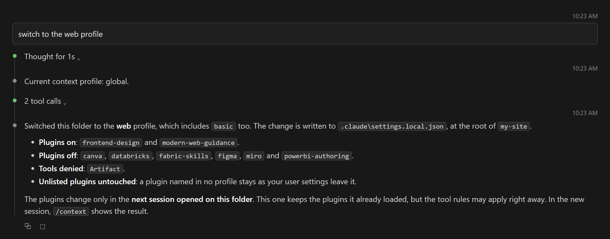
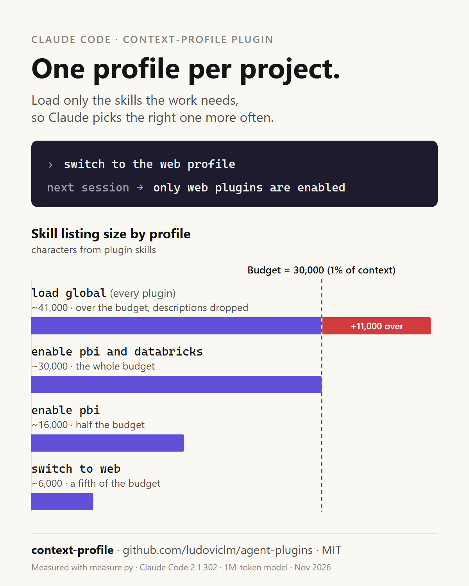

# context-profile

[](https://github.com/ludoviclm/agent-plugins/actions/workflows/ci.yml)
[](../../LICENSE)
[](#requirements)

**Load only the Claude Code plugins each project needs.** Say which profile you want, in plain
language, from inside the session:



The next session opened on that folder starts lighter, and says so:

```text
Context profile: basic + web
```

Why it matters: Claude Code lists every skill to the model within a fixed budget. Past it,
descriptions are dropped, and Claude no longer knows when to use those skills. Each profile
keeps a folder under budget, and the skill **measures** how much each plugin takes, so you
know what to cut.

## The problem



At session start, Claude Code sends the model a listing of every available skill: its name
and description. That listing has a budget. Above it, Claude Code drops descriptions, and a
skill without a description is a skill Claude no longer knows when to use.

- On Claude Code 2.1.302 (November 2026), the ceiling observed was about **30,000
  characters**: with 105 skills loaded, 43 were listed without a description. The budget is
  1% of the context window: `/context` showed the Skills line at 9.9k tokens, 1.0%, on a
  1M-token model. It varies with the model and the version.
- It fills up fast. Skill counts and listing weight of a few public plugins (`plugin:name` +
  description, counted on 2026-11-23):

  | Plugin | Skills | Characters |
  | --- | ---: | ---: |
  | `databricks@claude-plugins-official` 0.2.28 | 34 | ~14,600 |
  | `fabric-skills` from `microsoft/skills-for-fabric` | 27 | ~11,400 |
  | Five Power BI plugins of `power-bi-agentic-development` 26.40.9 | 20 | ~9,600 |

  Add your own skills, team skills, the ones Claude writes for you, and the skills synced from
  claude.ai: the budget is gone.

If your work moves between topics in the same week - a data platform in the morning, a
website in the evening, a document on Friday - you do not need all of it in every session.

## Quick start

### Requirements

- Claude Code: CLI, desktop app or IDE extension.
- Python 3.8+ on the `PATH`, as `python3` or `python`, standard library only. It runs the
  switch in one step, the session banner and the measure. Without it, Claude applies the
  profile by editing the settings file itself, and the banner stays silent.

### Install

From the [`ludoviclm` marketplace](../../README.md):

```text
/plugin marketplace add ludoviclm/agent-plugins
/plugin install context-profile@ludoviclm
```

It installs at the user scope (the default), so it is available in every folder. Then, in any
session, ask "create my context profiles": the skill offers to start from
[`profiles.example.json`](skills/context-profile/profiles.example.json).

Installed before the marketplace was renamed (`context-profile@context-profile`)? Remove the
old marketplace with `/plugin marketplace remove context-profile`, then run the two commands
above. Your `~/.claude/context-profiles.json` does not change.

Without the plugin system: copy `skills/context-profile/` to `~/.claude/skills/context-profile/`
to make it a personal skill. You get the switch and the measure, not the session banner,
which is a plugin hook.

## How it works

Profiles are declared once in `~/.claude/context-profiles.json`:

```json
{
  "marketplaces": {
    "claude-plugins-official": "anthropics/claude-plugins-official",
    "fabric-collection": "microsoft/skills-for-fabric"
  },
  "profiles": {
    "basic":      { "description": "Always on", "plugins": [], "tools": [] },
    "pbi":        { "description": "Power BI", "plugins": ["powerbi-authoring@fabric-collection"] },
    "fabric":     { "description": "Microsoft Fabric", "plugins": ["fabric-skills@fabric-collection"] },
    "databricks": { "description": "Databricks", "plugins": ["databricks@claude-plugins-official"] },
    "web":        { "description": "Static websites", "plugins": ["frontend-design@claude-plugins-official"] },
    "docs":       { "description": "Writing sessions", "tools": ["Artifact"] }
  }
}
```

- `marketplaces`: where to find each marketplace named in a plugin id, used to install
  missing plugins.
- `plugins`: plugin ids the profile turns on.
- `tools`: heavy tools the profile allows - a built-in tool such as `Artifact`, or
  `mcp__<server>` for every tool of an MCP server. Outside the profiles that list them, they
  are denied, which removes them from the context.
- `basic` is always included. Profiles are cumulative: `pbi docs` loads both. Names are
  case-insensitive.
- `global` turns everything on; `global except databricks` turns everything on but `databricks`.
- `reset` removes the profile entries from the folder: your user settings apply again.
- `announce` (optional, top level): see "The session banner" below.

Then, in any session:

```text
switch to the web profile
enable pbi and databricks
global except design
reset the profile of this folder
which profile is active?
how heavy are my plugins?
```

A small script, `apply.py`, does the switch in one step. It writes
`enabledPlugins` and `permissions.deny` in `.claude/settings.local.json` of
the folder the session was opened on, and leaves every other setting untouched. Claude Code
asks you to approve the command the first time. **The plugins of a profile apply to the
next session opened on that folder**; the tools may change in the current session already (see
"What I learned building it"). Each folder keeps its own profile: your client's website
does not inherit your data plugins.

**The session banner.** The plugin ships a `SessionStart` hook that shows the profile of
each new session: `Context profile: basic + web`. It merges your user, project and local
settings, and flags what does not match a profile exactly:

```text
Context profile: basic + pbi (partial 7/8) + docs
Context profile: basic + web (not installed: modern-web-guidance)
Context profile: global
Context profile: basic + pbi (no profile set in this folder: user settings apply)
```

The hook is silent when you have no configuration file. The VS Code extension records the
message without displaying it: set `"announce": true` at the top level of the configuration,
and Claude states the profile in its first reply instead.

**Missing plugins are installed on request.** When a profile names a plugin you do not have,
the skill lists it with its marketplace and asks before installing anything: a plugin is
third-party code. It installs at the local scope, for the current folder only, so that the
plugin does not switch on in every other folder. A teammate who receives your configuration
only has to say "switch to the pbi profile".

**List every heavy plugin in at least one profile.** The skill only switches the plugins your
profiles name: a plugin listed nowhere stays as your user settings leave it, on in every
folder. Run the measure first to see which ones to list.

The full example, [`profiles.example.json`](skills/context-profile/profiles.example.json),
has seven profiles, all from public marketplaces:

| Profile | Plugins |
| --- | --- |
| `basic` | none: the minimum, always on |
| `pbi` | `powerbi-authoring` from [Microsoft Skills for Fabric](https://github.com/microsoft/skills-for-fabric): reports and semantic models |
| `fabric` | `fabric-skills` from the same marketplace: 27 skills and three MCP servers |
| `databricks` | `databricks` (Anthropic official marketplace) |
| `design` | `figma`, `canva`, `miro` |
| `web` | `frontend-design`, `modern-web-guidance` |
| `docs` | no plugin: allows the `Artifact` page tool, denied elsewhere |

## Measuring

Ask "how heavy are my plugins?", or run it yourself from the repository root:

```bash
python plugins/context-profile/skills/context-profile/scripts/measure.py --project <folder>
```

```text
Source                                        On   Skills    Chars  Budget
databricks@claude-plugins-official            no       34   14,554     49%
claude.ai synced skills (a1b2c3d4)            ?        13    9,240     31%
semantic-models@power-bi-agentic-development  yes       6    3,069     10%
...
Enabled: 37 skills, 15,142 characters, 50% of a 30,000-character budget.
```

It is an estimate: built-in skills are not counted, and `/context` remains the reference.

## Customizing the skill

Everything specific to you lives in `~/.claude/context-profiles.json`; the skill itself does
not need editing. Ask Claude to change the file ("add a profile for my Python work"), or edit
it by hand.

- **Add a profile**: a name, a `description` (shown when you ask which profiles exist) and
  the `plugins` it turns on. Add the plugin's marketplace to `marketplaces` if it is new.
- **Combine profiles**: you can always ask for several at once ("enable pbi and databricks").
  If you often load the same set, declare it as one profile. For example, a `data` profile
  for a data engineer who works on Power BI and Databricks alike, listing the plugins of both:

  ```json
  "data": {
    "description": "Data platforms: Power BI, Fabric and Databricks.",
    "plugins": [
      "powerbi-authoring@fabric-collection",
      "fabric-skills@fabric-collection",
      "databricks@claude-plugins-official"
    ]
  }
  ```

  A profile lists plugins, not other profiles: when you add a plugin to `pbi`, add it to
  `data` too.
- **Split a heavy plugin into its own profile**: the example keeps `fabric-skills` (27 skills,
  three MCP servers) apart from `pbi`, so Power BI work does not carry the whole of Fabric.
  Both plugins also ship a `semantic-model-authoring` skill: kept apart, it is listed once unless you load both.
- **Cut a heavy tool**: list it in the `tools` of the profile that needs it (`Artifact`, or
  `mcp__<server>`). It is denied in every other profile. Denying an MCP server saves little
  today: see "What I learned building it".
- **Keep something always on**: put it in `basic`.
- **Keep something out of reach**: do not list it anywhere. A security or guardrail plugin
  listed in no profile is never switched off by the skill.
- **Change the budget used by the measure**: `measure.py --budget <characters>`, if your
  model or the `skillListingBudgetFraction` setting gives a different ceiling.

## What I learned building it

- **Cutting a plugin saves few tokens, but gives descriptions back to the other skills.** The
  win is routing: Claude picks the right skill more often.
- **The big token savings are tools, not skills.** On my setup, the `Artifact` tool alone
  weighed about 13,000 tokens.
- **MCP servers weigh little, as long as their tools are deferred.** With tool search on (the
  default), MCP tools are loaded on demand: `/context` shows them as "MCP tools (deferred)",
  outside the total. On Claude Code 2.1.302, denying eight MCP servers (about 119,000 tokens
  of deferred tools) left the session total unchanged, and the servers' instructions stayed.
  Denying a server is still useful to keep its tools out of reach.
- **Tools follow a switch in the current session, plugins do not.** Claude Code reloads the
  permission rules while the session runs, but loads plugins only at start. On Claude Code
  2.1.330, switching from `web` to `global` made the `Artifact` tool available in the running
  session right away, while the new plugins waited for the next one. The reverse, a tool denied
  mid-session, was not tested.
- **A `Skill(<name>)` deny rule does not hide a skill.** It blocks the call, but the skill
  stays in the listing. The granularity is the plugin, or the tool.

## Limits

- Claude Code only (CLI, desktop app, IDE extensions), not the claude.ai chat. GitHub Copilot
  CLI and VS Code can install it from the marketplace, but it only manages Claude Code
  settings.
- No per-skill granularity inside a plugin.
- Two sessions opened on the same folder share the same file: switch, then open the second.
- The banner needs Python (see [Requirements](#requirements)).
- Keep guardrail or security plugins out of the configuration: the skill only touches the
  plugins you list, so an unlisted plugin is never switched off.
- A profile cannot allow a tool your user settings deny: deny rules of every scope add up.
  The status then shows that profile as partial.

## Alternatives

Worth knowing, and they combine well with profiles (checked on 2026-11-22; confirm against
the current Claude Code documentation):

- **Native settings**: `/skills` and `skillOverrides` hide personal and project skills one by
  one, but not plugin skills; `skillListingBudgetFraction` enlarges the listing budget, at the
  cost of more tokens in every session.
- **Profile managers outside Claude**:
  [claude-code-profiles](https://pypi.org/project/claude-code-profiles/) (Python CLI),
  [jig](https://github.com/jdforsythe/jig), [cue](https://github.com/recodeeai/cue).

What context-profile does differently: it is a skill, driven in plain language from inside
the session, with nothing else to install, cumulative profiles, and a measure of each
plugin's weight.

## License

[MIT](../../LICENSE)
